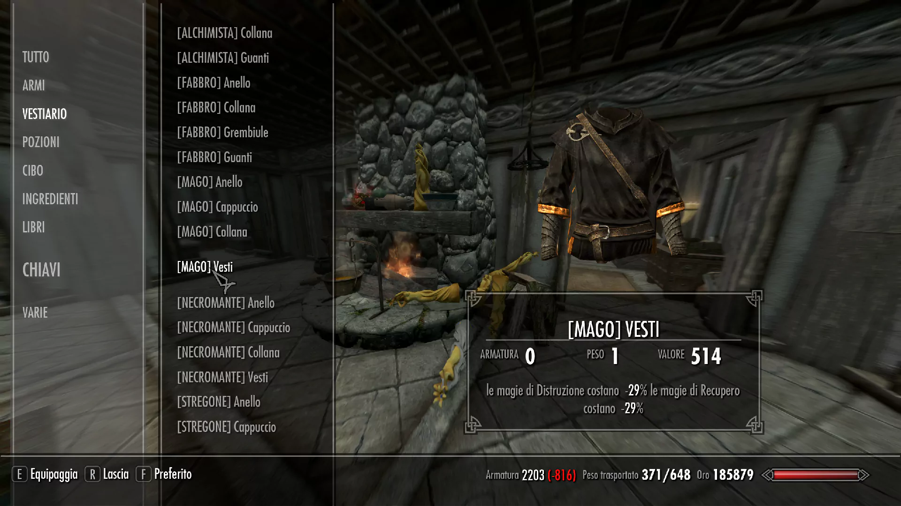

# My Gameplay Notes (IT)
I'm playing The Elder Scrolls V: Skyrim Special Edition (unmodded) with Dawnguard, Dragonborn, and Hearthfire, along with Survival Mode, Fishing, Rare Curios, and Saints and Seducers installed, using the Italian localization, which is terrible. I'll switch to the original English language once I finish my first playthrough. I might add an English translation later.

- [1. Farming Sets](#kit)
- [2. Gilda dei Ladri](#guild)
- [3. Ricettario Alchemico](#recipes)
- [Credits & License](#credits)
- [Connect](#connect)

## 1. Farming Sets 
Per rinominare un oggetto, premi `F` al tavolo dell'arcanista prima di concludere l'incantamento.

### NOMI
- [ALCHIMISTA] Anello / Collana / Cappello / Guanti
- [FABBRO] Anello / Collana / Grembiule / Guanti
- [MAGO] Anello / Collana / Cappuccio / Veste
- [NECROMANTE] Anello / Collana / Cappuccio / Veste
- [STREGONE] Anello / Collana / Cappuccio / Veste

**Nota:** *In Skyrim gli oggetti nell'inventario vengono ordinati in base ai caratteri ASCII usati nel nome. Avendo le parentesi quadre un valore più alto rispetto alle lettere, questi kit finiscono in fondo: per questo ho scelto di usarle.*

### ID ITEM
Gli incantesimi si possono applicare solo su determinati pezzi di equipaggiamento, quindi la selezione del tipo è obbligatoria. 
Gemme ed estetica sono puramente estetiche, ho scelto in base al mio gusto e alla disponibilità del mio magazzino. 
I gioielli si possono craftare nella forgia, usando lingotti di minerale e gemme preziose. Non è necessario usare gemme perfette.
Scelgo il diamante perchè così posso fare un set coordinato, essendo l'unica gemma che si può mettere sia sull'anello che sulla collana.
Le vesti civili si possono comprare al negozio Radiose Vesti di Solitude.

- Anello d'oro con diamante: `player.additem 000877c9 5`
- Collana d'oro con diamante: `player.additem 000877f1 5`
- Cappello (bandana bianca): `player.additem 000330b3 1`
- Grembiule da fabbro chiaro: `player.additem 0006ff37 1`
- Guanti: `player.additem 000261c1 2`
- Vesti del vagabondo: `player.additem 05000e4a 3`
- Cappuccio del vagabondo: `player.additem 05000e4b 3`
- Gemma dell'anima suprema piena `player.additem 0002e4ff 20`

**Nota:** *Per ricevere l'oggetto con il comando `player.additem` serve il suo BaseID, da non confondere con il RefID che identifica l'oggetto in una determinata istanza. Droppa l'item a terra e cliccalo con la console aperta per vederli entrambi.*

### POZIONE
- Incantare usando una pozione di Fortifica Incantamento al 32%. 
- Si ottiene con Alchimia al 100, bonus su Alchimista 5/5, Guaritore, Benefattore. 
- E usando un Set `[ALCHIMISTA]` con Fortifica Alchimia al 29%.

**Ricetta**: Baccaneve e Ali di farfalla blu sono i due ingredienti utili più comuni. Il primo si trova facilmente in luoghi innevati come Dawnstar, le farfalle blu spawnano un po'ovunque, anche nella tua serra se hai una delle case dell'espansione HearthFire.

### INCANTAMENTI
- [ALCHIMISTA] Fortifica Alchimia su tutti i pezzi + Fortifica Oratoria sulla Collana
- [FABBRO] Fortifica Forgiatura + Fortifica Carico Massimo su tutti i pezzi tranne il Grembiule
- [MAGO] Fortifica Distruzione e Fortifica Recupero su tutti i pezzi
- [NECROMANTE] Fortifica Alterazione e Fortifica Evocazione su tutti i pezzi
- [STREGONE] Fortifica Distruzione e Fortifica Illusione su tutti i pezzi

**Nota:** *Per applicare entrambi gli enchant è necessario il perk Effetto Extra, sbloccabile con Incantamento al livello 100.* 

## 2. Bacheca della Gilda dei Ladri 

Contatore lavoretti: `GetGlobalValue TGRMasterTotal`. I lavoretti (*radiant quests*) di Delvin Mallory e Vex nella Cisterna della Caraffa Logora sbloccano i trofei sugli scaffali dietro la scrivania del Capogilda e ricompense extra.

* 5: Jeweled Candlestick
* 15: Ornate Drinking Horn
* 25: Golden Ship Model
* 35: Golden Urn
* 45: Jeweled Goblet
* 55: Jeweled Flagon
* 75: Jeweled Pitcher
* 125: Safe next to the shelves (respawning random loot and stealth potions)
* City influence: 5 jobs in each of the 4 major holds (Whiterun, Windhelm, Markarth, Solitude) unlock special reputation quests, new merchants/fences in the Ragged Flagon Cistern, and Guild Master's armor

### Extra Items & Trophies

* **Company Map:** Appears on the wall near the safe in the Ragged Flagon Cistern after completing the *Taking Care of Business* quest (and advances as you complete city reputation quests)
* **Crown of Barenziah:** Appears in the display case on the shelf behind the Guildmaster's desk in the Ragged Flagon Cistern after collecting all 24 Stones of Barenziah, speaking to Vex, retrieving the crown from Tolvald's Cave during *Blindsighted* / *No Stone Unturned*, and placing it on the bust
* **Merchant & Fence Stalls:** Unlocked in the Ragged Flagon Cistern by completing the special city reputation quests for Whiterun, Windhelm, Markarth, and Solitude (5 small jobs per hold plus the reputation quest from Delvin)
* **Guild Master's Armor:** Given by Tonilia after unlocking all four city reputation quests and becoming Guild Master

### Stones of Barenziah (24)

**Whiterun**
* Dragonsreach — Jarl Balgruuf's quarters (side table/nightstand)
* Bannered Mare — Hulda's upstairs room (dresser/table)
* Hall of the Dead — Catacombs (behind iron gate/coffins)
* Jorrvaskr — Kodlak Whitemane's bedroom (table)

**Windhelm**
* Palace of the Kings — Upstairs left room / Wuunferth's quarters
* House of Clan Shatter-Shield — Upstairs bedroom (desk)
* Hjerim — Master bedroom (desk/table; during *Blood on the Ice* or after buying the house)

**Markarth**
* Treasury House — End-table in the room with the safe
* Understone Keep — Dwemer Museum (table/display)
* Stone Quarters — Nepos the Nose's house (back room table)

**Solitude**
* Blue Palace — Jarl Elisif's bedroom (bedside table)
* Proudspire Manor — Master bedroom (nightstand; requires buying the house)

**Riften**
* Mistveil Keep — Jarl's quarters (nightstand)
* Black-Briar Lodge — Upstairs bedroom (table)

**Winterhold**
* College of Winterhold — Arch-Mage's Quarters (table near bed/alchemy area)

**Dungeons & World**
* Ansilvund Burial Chambers — Boss room (table near Lu'ah Al-Skaven)
* Blackreach — Sinderion's Field Laboratory (table)
* Dainty Sload — Captain's quarters (table; ship near Solitude docks)
* Fellglow Keep — Boss/ritual room (table)
* Pinewatch — Bandit sanctuary / treasure room (table)
* Rannveig's Fast — Lower level/prison area (table)
* Stony Creek Cave — Bandit camp/table inside the cave
* Yngvild — Throne room / boss area (table)

### 3. Ricettario Alchemico 

| Effetto | Ingredienti | Note |
| :--- | :--- | :--- |
| **Fortifica carico massimo** | Rampicanti, Pholiota squamosa, Mora tapinella | Alto valore per fare septim |
| **Veleno paralizzante e danno salute** | Radice canina, Ceppo di folletto, Campanula mortale | Veleno preferito |
| **Fortifica salute** | Grano, Fiore blu di montagna | Cura ordinaria |
| **Resistenza al fuoco** | Lingua di drago, Orecchio di elfo | 🔥 |
| **Borseggiare** | Libellula blu, Libellula arancione | 👀 |
| **Ripristino magicka** | Mora tapinella, Orecchio di elfo | ✨ |
| **Furtività e resistenza al gelo** | Fiore viola di montagna, Mirra del gelo | ❄️ |
| **Invisibilità e ripristino salute** | Ala di falena, Polvere di vampiro | 👻 |
| **Fortifica magicka e ripristino magicka** | Cotone della tundra, Fiore rosso di montagna, Olio nanico | ✨ |
| **Resistenza magica e fortifica parata** | Corona insanguinata, Cotone della tundra | 🛡️ |
| **Fortifica oratoria** | Ali di farfalla, Cotone della tundra | 💰 |
| **Fortifica armi a una mano e fortifica salute** | Artigli di orso, Fungo luminoso, Piume di falco | ⚔️ |
| **Fortifica tiro** | Bacche di ginepro, Orecchio di elfo | 🏹 |

## Credits & License 
<!-- Aggiungo un'ancora HTML con id="credits" per avere un link più corto e far funzionare l'indice anche se cambio il titolo. Non è obbligatoria, GitHub ne crea una automaticamente -->

- **Repository License:** Unless otherwise specified, all other original content in this repository is governed by the terms in the main [README](../README.md).
- **Disclaimer:** This is an unofficial personal reference and is not affiliated with, endorsed, or sponsored by Bethesda Softworks or ZeniMax Media. *The Elder Scrolls V: Skyrim* and related game content are trademarks and property of their respective owners.

## Connect

