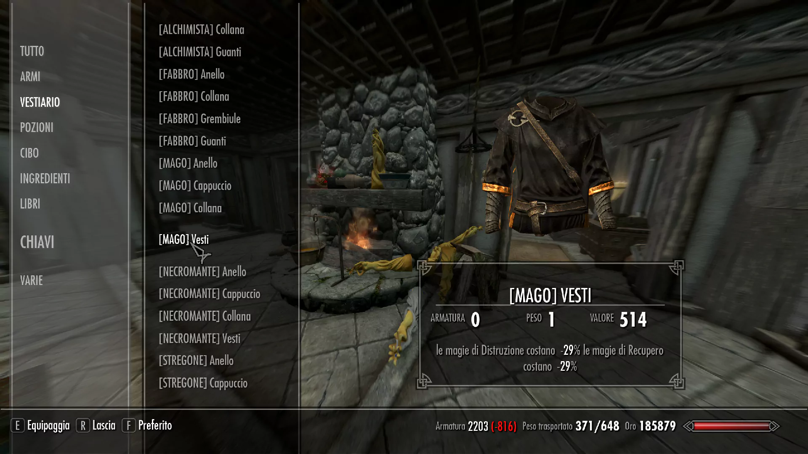

# My Notes (IT)
I'm playing The Elder Scrolls V: Skyrim Special Edition (unmodded) with Dawnguard, Dragonborn, and Hearthfire, along with Survival Mode, Fishing, Rare Curios, and Saints and Seducers installed, using the Italian localization, which is terrible. I'll switch to the original English language once I finish my first playthrough. I might add an English translation later.

> **Credits:** *The Elder Scrolls V: Skyrim Special Edition* and related game content are property of Bethesda Softworks / ZeniMax Media.

## 1. Farming Sets
Per rinominare un oggetto, premi `F` al tavolo dell'arcanista prima di concludere l'incantamento.

### NOMI
- [ALCHIMISTA] Anello / Collana / Cappello / Guanti
- [FABBRO] Anello / Collana / Grembiule / Guanti
- [MAGO] Anello / Collana / Cappuccio / Veste
- [NECROMANTE] Anello / Collana / Cappuccio / Veste
- [STREGONE] Anello / Collana / Cappuccio / Veste

**Nota:** *In Skyrim gli oggetti nell'inventario vengono ordinati in base ai caratteri ASCII usati nel nome. Avendo le parentesi quadre un valore più alto rispetto alle lettere, questi kit finiscono in fondo: per questo ho scelto di usarle.*

### ID ITEM
Gli incantesimi si possono applicare solo su determinati pezzi di equipaggiamento, quindi la selezione del tipo è obbligatoria. 
Gemme ed estetica sono puramente estetiche, ho scelto in base al mio gusto e alla disponibilità del mio magazzino. 
I gioielli si possono craftare nella forgia, usando lingotti di minerale e gemme preziose. Non è necessario usare gemme perfette.
Scelgo il diamante perchè così posso fare un set coordinato, essendo l'unica gemma che si può mettere sia sull'anello che sulla collana.
Le vesti civili si possono comprare al negozio Radiose Vesti di Solitude.

- Anello d'oro con diamante: `player.additem 000877c9 5`
- Collana d'oro con diamante: `player.additem 000877f1 5`
- Cappello (bandana bianca): `player.additem 000330b3 1`
- Grembiule da fabbro chiaro: `player.additem 0006ff37 1`
- Guanti: `player.additem 000261c1 2`
- Vesti del vagabondo: `player.additem 05000e4a 3`
- Cappuccio del vagabondo: `player.additem 05000e4b 3`
- Gemma dell'anima suprema piena `player.additem 0002e4ff 20`

**Nota:** *Per ricevere l'oggetto con il comando `player.additem` serve il suo BaseID, da non confondere con il RefID che identifica l'oggetto in una determinata istanza. Droppa l'item a terra e cliccalo con la console aperta per vederli entrambi.*

### POZIONE
- Incantare usando una pozione di Fortifica Incantamento al 32%. 
- Si ottiene con Alchimia al 100, bonus su Alchimista 5/5, Guaritore, Benefattore. 
- E usando un Set `[ALCHIMISTA]` con Fortifica Alchimia al 29%.

**Ricetta**: Baccaneve e Ali di farfalla blu sono i due ingredienti utili più comuni. Il primo si trova facilmente in luoghi innevati come Dawnstar, le farfalle blu spawnano un po'ovunque, anche nella tua serra se hai una delle case dell'espansione HearthFire.

### INCANTAMENTI
- [ALCHIMISTA] Fortifica Alchimia su tutti i pezzi + Fortifica Oratoria sulla Collana
- [FABBRO] Fortifica Forgiatura + Fortifica Carico Massimo su tutti i pezzi tranne il Grembiule
- [MAGO] Fortifica Distruzione e Fortifica Recupero su tutti i pezzi
- [NECROMANTE] Fortifica Alterazione e Fortifica Evocazione su tutti i pezzi
- [STREGONE] Fortifica Distruzione e Fortifica Illusione su tutti i pezzi

**Nota:** *Per applicare entrambi gli enchant è necessario il perk Effetto Extra, sbloccabile con Incantamento al livello 100.* 

## Connect

